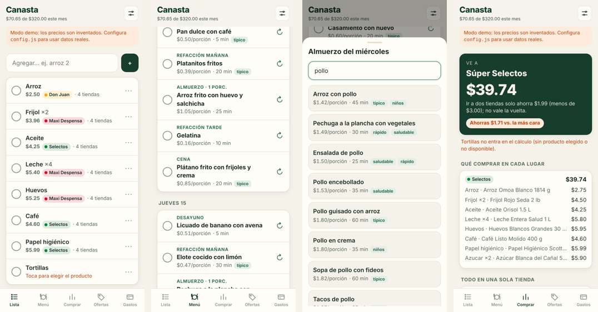

# 🧺 Canasta SV

App para el celular (iPhone y Android) que junta la **lista del súper**, el **menú de la semana (desayunos, refacciones, almuerzos y cenas)**, el **presupuesto del mes** y un **comparador de precios** de supermercados de El Salvador. Te arma qué cocinar con lo más barato de la semana, te pasa los ingredientes a la lista Te dice si conviene comprar todo en un solo lugar o dividir la compra entre dos tiendas, y solo te manda a la segunda si el ahorro vale la vuelta.

**Costo mensual: $0.** Todo corre en planes gratuitos.



> **Para Claude Code:** este README es tu guía de instalación. Sigue la sección
> [🤖 Instalación paso a paso](#-instalación-paso-a-paso-para-claude-code) en orden y
> marca cada casilla de la [lista de verificación](#-lista-de-verificación-final). Lee también `CLAUDE.md`.

---

## Qué hace

| Pantalla | Para qué |
|---|---|
| **Menú** | Estilo NeatEat. Eliges qué comidas planear (desayuno, refacción de la mañana, almuerzo, refacción de la tarde, cena) en una cuadrícula de día × comida, con plantillas rápidas ("Solo almuerzos", "Desayuno + almuerzo", "Todo el día"…), y cuántas porciones lleva cada comida. Con tu presupuesto, gustos, aparatos y lo que ya tienes en casa, arma la semana con un recetario de 68 platos salvadoreños y cotidianos, usando los precios reales de hoy. Puedes cambiar cualquier comida al azar o elegirla del recetario, ver la receta con cantidades y pasos, y mandar los ingredientes a la lista con un toque. Sin IA de pago: $0. |
| **Lista** | Escribes "arroz 2", eliges el producto exacto y ves en qué tienda sale más barato. La lista se comparte en vivo entre los dos celulares. |
| **Dónde comprar** | Arma el plan más barato: una sola tienda, o dos si te ahorras más de lo que tú definas (por defecto $3). Te dice qué comprar en cada lugar. |
| **Ofertas** | Productos con precio por debajo de su precio normal o de su máximo de los últimos 60 días. Filtro "De mi lista". |
| **Gastos** | Presupuesto por categoría (Súper, Mercado, Limpieza…), gastos registrados y cuánto te queda en el mes. |

Tiendas:

| Tienda | Cómo se leen los precios | Estado |
|---|---|---|
| Walmart | API pública VTEX (`/api/catalog_system/pub/products/search`) | ✅ Verificado el 2026-10-09 |
| Maxi Despensa | API pública VTEX | ✅ Verificado el 2026-10-09 |
| La Despensa de Don Juan | API pública VTEX | ✅ Verificado el 2026-10-09 |
| Súper Selectos | Navegador automático (Playwright) que lee el HTML | ⚠️ **Por verificar** (ver paso 7) |

El mismo producto se empareja entre Walmart, Maxi y Don Juan por **código de barras (EAN)**. Selectos no publica código de barras, así que se empareja por nombre o lo marcas tú en el selector.

## Cómo está armado

```
 Celular (iPhone / Android)                         GitHub (gratis)
 ┌──────────────────────────┐                 ┌───────────────────────────────┐
 │ App web instalable (PWA) │◄── GitHub Pages │ Actions, todos los días 6 a.m.│
 │ web/                     │                 │ scraper/actualizar.mjs        │
 └───────────┬──────────────┘                 │  ├─ Walmart / Maxi / Don Juan │
             │ lista, gastos, precios         │  └─ Selectos (Playwright)     │
             ▼                                └──────────────┬────────────────┘
 ┌───────────────────────────────────────┐                   │ guarda precios
 │ Supabase (gratis)                     │◄──────────────────┘
 │ Postgres + login por código al correo │
 │ Edge Function "precios" (buscar ahora)│
 └───────────────────────────────────────┘
        ▲  plan B: si Selectos bloquea a GitHub, la compu de la casa
        └─ corre scraper/tarea-windows.ps1 una vez al día.
```

## Costos

| Servicio | Plan | Costo | Notas |
|---|---|---|---|
| GitHub (repo público + Actions + Pages) | Free | $0 | Actions es ilimitado en repos públicos. La app queda en `https://USUARIO.github.io/canasta-sv/`. |
| Supabase | Free | $0 | 500 MB de base de datos, login por correo y Edge Functions. El proyecto se pausa si pasa 7 días sin uso; el robot diario lo mantiene activo. |
| Dominio | — | $0 | No hace falta. |
| Compu de la casa | — | luz | Solo si se usa el plan B de Selectos. |

Verifica los límites actuales en supabase.com/pricing y docs.github.com. Para que la base no crezca, el historial de precios **solo guarda una fila cuando un precio cambia**.

> **¿Por qué repo público?** GitHub Pages gratis requiere repo público. El código queda visible, pero **los datos no**: la lista, los gastos y los precios están protegidos con reglas de seguridad (RLS) y solo los correos de la tabla `miembros` pueden verlos. Las llaves secretas van en *GitHub Secrets*, nunca en el código. Si prefieres repo privado, usa Cloudflare Pages (también gratis) para publicar `web/`.

## Estructura

```
canasta-sv/
├─ web/                         App (HTML/CSS/JS sin compilación)
│  ├─ index.html, estilos.css, app.js
│  ├─ datos.js                  Supabase real + modo demo
│  ├─ optimizador.js            Decide dónde comprar (lógica pura, con pruebas)
│  ├─ menu/recetas.js           Almuerzos + junta todo el recetario (RECETAS)
│  ├─ menu/recetas-desayunos.js Desayunos
│  ├─ menu/recetas-cenas.js     Cenas
│  ├─ menu/recetas-refacciones.js Refacciones para los breaks
│  ├─ menu/ingredientes.js      Ingredientes: cómo buscarlos en tiendas + precio de referencia
│  ├─ menu/planificador.js      Arma la semana por día y comida: costo, variedad, presupuesto, despensa
│  ├─ config.js                 URL + llave PÚBLICA de Supabase  ← se edita en el paso 5
│  └─ manifest.webmanifest, sw.js, icons/
├─ supabase/
│  ├─ migrations/…_canasta.sql  Tablas, seguridad (RLS), funciones y vista de ofertas
│  ├─ migrations/…_menu.sql     Menú semanal compartido + precios por ingrediente
│  ├─ migrations/…_menu_completo.sql  Términos de ingredientes de desayunos, cenas y refacciones
│  ├─ functions/precios/        Edge Function "Buscar ahora" (Deno)
│  ├─ functions/_shared/vtex.mjs  Lector de precios VTEX (lo comparten la función y el robot)
│  └─ config.toml
├─ scraper/
│  ├─ actualizar.mjs            Robot diario
│  ├─ selectos.mjs              Lector de Súper Selectos (Playwright)
│  ├─ probar.mjs                Prueba rápida sin base de datos
│  ├─ agregar-miembro.mjs       Agrega o quita correos del hogar
│  ├─ tarea-windows.ps1         Plan B: tarea programada de Windows para Selectos
│  └─ .env.example
├─ tests/                       node --test tests/*.test.mjs
└─ .github/workflows/           precios.yml (diario) y pages.yml (publicar app)
```

## Ver la app ya (modo demo, sin cuentas)

```bash
npx serve web          # o: python -m http.server 8080 --directory web
```
Abre `http://localhost:3000/?demo` (o el puerto que diga). Los precios del demo son **inventados**.

---

## 🤖 Instalación paso a paso (para Claude Code)

La compu es **Windows**. Usa PowerShell. Pide al usuario solo lo que no puedas hacer tú (crear cuentas, iniciar sesión en el navegador, pegar llaves). **Nunca pongas la llave secreta en `web/`, en commits ni en el chat**: va en `scraper/.env` y en GitHub Secrets.

### Paso 0 · Herramientas

```powershell
node --version    # necesita v22 o más nuevo (usa process.loadEnvFile)
git --version
gh --version      # si falta: winget install --id GitHub.cli
```
Si falta Node 22: `winget install OpenJS.NodeJS.LTS`. Luego:
```powershell
npm install --prefix scraper
node --test tests/*.test.mjs          # deben pasar todas
```

### Paso 1 · Comprobar que las tiendas responden desde esta compu

```powershell
node scraper/probar.mjs "arroz omoa"
node scraper/probar.mjs leche
```
Debe listar productos con precio en Walmart, Maxi y Don Juan. Revisa también productos a granel, que usa el menú:
```powershell
node scraper/probar.mjs tomate
node scraper/probar.mjs "pechuga pollo"
```
Para que el costo del menú salga bien, cada producto debe traer su tamaño (`contenido` en g, ml o und). Si los productos por libra salen sin tamaño o con un precio raro, revisa qué traen `measurementUnit` y `unitMultiplier` en la respuesta JSON y ajusta `contenidoPorMedida()` en `vtex.mjs`. Si una tienda da error 403/404, revisa en el navegador que `https://<tienda>/api/catalog_system/pub/products/search?ft=arroz` siga respondiendo JSON y ajusta `TIENDAS_VTEX` en `supabase/functions/_shared/vtex.mjs`.

### Paso 2 · Crear el proyecto de Supabase

1. El usuario crea una cuenta gratis en supabase.com (puede entrar con GitHub).
2. Inicia sesión en la CLI: `npx supabase login` (abre el navegador).
3. Crea el proyecto (o pide al usuario que lo cree en el panel: **New project → nombre `canasta-sv`, región East US, plan Free**):
   ```powershell
   npx supabase orgs list
   npx supabase projects create canasta-sv --org-id <ORG_ID> --region us-east-1 --db-password "<genera una fuerte y guárdala>"
   npx supabase projects list            # anota el REFERENCE ID
   npx supabase projects api-keys --project-ref <REF>
   ```
4. Copia `scraper/.env.example` a `scraper/.env` y llena `SUPABASE_URL=https://<REF>.supabase.co` y `SUPABASE_SERVICE_KEY` con la llave **secret/service_role**. Si las llaves salen en el panel, pide al usuario que las pegue él mismo en `scraper/.env`.

### Paso 3 · Crear la base de datos

```powershell
npx supabase link --project-ref <REF>
npx supabase db push
```
(Alternativa: pegar `supabase/migrations/20261009000000_canasta.sql` en **SQL Editor → Run**. Es idempotente.)

Agrega a los miembros del hogar. Los correos **no** se guardan en el repo:
```powershell
node scraper/agregar-miembro.mjs <correo-de-guille> Guille
node scraper/agregar-miembro.mjs <correo-de-la-tia> Tía
node scraper/agregar-miembro.mjs --ver
```

Primera carga de precios:
```powershell
node scraper/actualizar.mjs --sin-selectos
```
Debe decir algo como `VTEX: 900 productos, 900 precios nuevos o cambiados.`

### Paso 4 · Login con código al correo

El login usa un **código de 6 dígitos**, no un link, porque en iPhone el link abriría Safari y no la app instalada. En el panel de Supabase:

1. **Authentication → Sign In / Providers → Email**: activado. "Confirm email" puede quedar activado.
2. **Authentication → Emails → Templates → Magic Link**: cambia el cuerpo para que muestre el código:
   ```html
   <h2>Tu código para Canasta</h2>
   <p style="font-size:28px;letter-spacing:4px"><b>{{ .Token }}</b></p>
   <p>Vence en una hora.</p>
   ```
   Haz lo mismo en **Confirm signup**, porque la primera vez de cada correo Supabase manda ese.
3. **Authentication → URL Configuration → Site URL**: `https://<usuario-github>.github.io/canasta-sv/`.

El correo gratis de Supabase tiene un límite bajo de envíos por hora. Para dos personas sobra, y la sesión queda abierta en el cel.

### Paso 5 · Edge Function "Buscar ahora"

```powershell
npx supabase functions deploy precios --project-ref <REF> --no-verify-jwt
```
Si pide Docker, agrega `--use-api`. La función revisa ella misma que quien llama sea miembro del hogar. Opcional: `npx supabase secrets set CRON_SECRET=<algo-largo> --project-ref <REF>` permite llamarla desde fuera con ese secreto.

Edita `web/config.js` con `SUPABASE_URL` y la llave **publishable/anon**, que es pública por diseño.

### Paso 6 · GitHub: repo, robot diario y publicación

```powershell
gh auth login
git init -b main
git add .
git commit -m "Canasta SV"
gh repo create canasta-sv --public --source . --push
gh secret set SUPABASE_URL --body "https://<REF>.supabase.co"
gh secret set SUPABASE_SERVICE_KEY          # pega la llave secreta cuando la pida
gh api -X POST "repos/{owner}/canasta-sv/pages" -f build_type=workflow
gh workflow run pages.yml
gh workflow run precios.yml
gh run watch
```
La app queda en `https://<usuario>.github.io/canasta-sv/`. Ábrela y entra con el correo.

Antes de hacer push, revisa con `git status` que `scraper/.env` **no** aparezca.

### Paso 7 · Súper Selectos (verificar y ajustar)

Selectos es una app Blazor detrás de Cloudflare, sin API. El 2026-10-09 su buscador respondió **"The service is unavailable"** a pruebas automáticas, así que `scraper/selectos.mjs` se escribió con selectores genéricos y **hay que verificarlo**:

```powershell
npx --prefix scraper playwright install chromium
node scraper/selectos.mjs --descubrir
```
Revisa `scraper/selectos-debug/` (`muestra.json`, `categoria.html`, `*.png`):
- Si `muestra.json` trae nombres y precios correctos, sigue con `node scraper/selectos.mjs --seco`.
- Si viene vacío o raro, abre `categoria.html` y ajusta `extraerTarjetas()` a la estructura real de las tarjetas. Si las categorías paginan, ajusta `cargarTodo()`. Respeta las pausas: es uso personal, una vez al día.
- Con `--seco` bien, corre `node scraper/selectos.mjs` para guardar.

Después mira el log de la corrida de GitHub (`gh run view --log`):
- Si Selectos funcionó desde GitHub, no hay que hacer más.
- Si dice `⚠ Selectos bloqueó`, apágalo en GitHub y actívalo en la compu:
  ```powershell
  gh variable set SELECTOS --body 0
  powershell -ExecutionPolicy Bypass -File scraper\tarea-windows.ps1
  ```
  La tarea corre a las 6:30 a.m. y, si la compu estaba apagada, en cuanto se encienda.

### Paso 8 · Instalar en los celulares

- **iPhone**: abrir el link en **Safari** → Compartir → **Agregar a inicio**.
- **Android**: abrir en **Chrome** → menú ⋮ → **Instalar app**.

Cada quien entra con su correo, que debe estar en `miembros`, y escribe el código que le llega.

---

## ✅ Lista de verificación final

- [ ] `node --test tests/*.test.mjs` pasa.
- [ ] `node scraper/probar.mjs arroz` muestra precios de las 3 tiendas VTEX.
- [ ] La tabla `productos` tiene filas de `walmart`, `maxi` y `donjuan`.
- [ ] El workflow **Precios diarios** terminó en verde.
- [ ] La app abre en `github.io`, llega el código al correo y entra.
- [ ] Agregar "leche" → elegir producto → aparece el precio en varias tiendas.
- [ ] "Buscar en tiendas" dentro del selector trae productos nuevos (Edge Function).
- [ ] "Dónde comprar" muestra una recomendación.
- [ ] **Menú**: elegir una plantilla (ej. "Todo el día") y ajustar la cuadrícula → "Armar mi semana" → aparece cada día con sus comidas y costos; los filtros por comida funcionan; ↻ cambia una comida; "Elegir otra" abre el recetario; "Agregar a mi lista" pasa los ingredientes.
- [ ] Después de la corrida diaria, en Menú desaparece "Algunos precios son estimados" para la mayoría de ingredientes (o se reduce).
- [ ] Registrar un gasto actualiza la barra del mes.
- [ ] En el segundo celular la lista cambia sola al marcar algo en el primero (tiempo real).
- [ ] Selectos: verificado y corriendo en GitHub **o** en la tarea de Windows.
- [ ] `scraper/.env` no está en el repo y `web/config.js` no tiene la llave secreta.

## Mantenimiento

- **Cambiaste algo en `web/`**: sube `VERSION` en `web/sw.js` para que los celulares bajen la versión nueva.
- **Robot diario**: GitHub apaga los workflows programados tras 60 días sin actividad; el "latido mensual" del workflow lo evita.
- **Una tienda cambió su página**: el workflow falla si no se pudo leer ninguna tienda VTEX. Corre `node scraper/probar.mjs arroz` para ver cuál.
- **Agregar otra tienda VTEX** (por ejemplo PriceSmart, si usa VTEX): agrégala en `TIENDAS_VTEX` y en la tabla `tiendas`.
- **Uso responsable**: una consulta al día, con pausas, para uso personal. No subas la frecuencia.

## Cómo arma el menú (sin IA, $0)

1. **Qué planear**: cada combinación día × comida marcada en la cuadrícula es un espacio a llenar, con sus porciones (por defecto las del hogar; los niños cuentan media).
2. **Precios**: para cada ingrediente busca los productos reales (`candidatos_ingredientes`), descarta los que no son el ingrediente (ej. "sopa sabor pollo", "semidescremada" para crema) y usa el más barato por gramo, ml o unidad. Si todavía no hay precio real, usa uno de referencia y lo marca como *estimado*.
3. **Elegir recetas**: para cada espacio busca solo recetas de ese tipo de comida (`tiempos`) y escoge la que menos cuesta comprar, con estas reglas:
   - **Repeticiones**: un almuerzo o cena no se repite en la semana; un desayuno, máximo 2 veces; una refacción, máximo 3.
   - **Variedad**: el almuerzo y la cena del mismo día no llevan la misma proteína, ni se repite la proteína del día anterior; las dos refacciones del día alternan dulce y salado.
   - **Entre semana**: desayunos y refacciones rápidos.
   - **Bonos**: por tu estilo, por reaprovechar ingredientes que ya se compran esa semana y por ofertas.
   - **Azar**: un toque para que "Generar otro menú" cambie.
4. **Presupuesto**: si se pasa, cambia las comidas más caras por recetas más baratas del mismo tipo.
5. **Compras**: suma lo de toda la semana, quita lo que ya tienes y redondea a paquetes reales, eligiendo la presentación más barata en total.

**Agregar recetas**: ponlas en el archivo de su comida (`recetas-desayunos.js`, `recetas-cenas.js`, `recetas-refacciones.js` o `recetas.js`), con `tiempos` indicando en qué comidas pueden salir.
- Si la receta usa un ingrediente nuevo, agrégalo en `ingredientes.js` y su término en una migración nueva de `terminos`.
- Corre las pruebas: verifican ingredientes, tiempos y costos de todo el recetario.

## Ideas para después (no incluidas)

- **Recetas con IA**: además del recetario, pedirle a un modelo ideas nuevas con lo que hay en oferta. Requiere una Edge Function que llame a la API de Claude con un modelo pequeño; cuesta centavos por menú, pero **ya no es $0**.
- Postres y bebidas como comidas aparte.
- Escanear el ticket con la cámara para registrar el gasto automáticamente.
- Alerta (notificación push) cuando algo de tu lista baja de precio.
